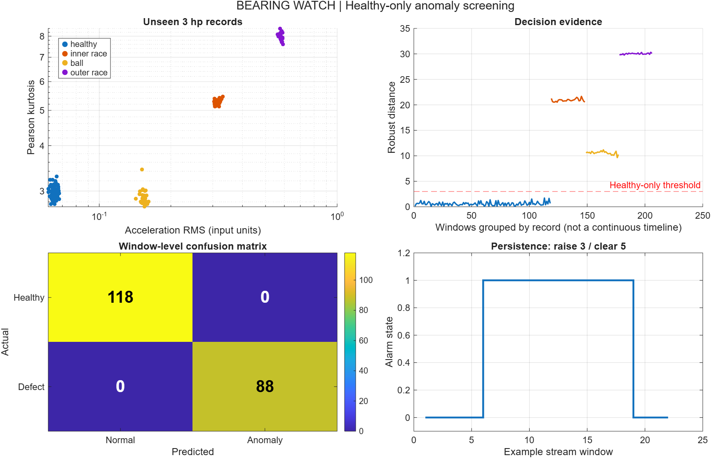

# Bearing Watch — explainable vibration screening in MATLAB

An industrial condition-monitoring portfolio project: turn raw accelerometer records into auditable anomaly decisions, with healthy-only calibration, explicit data-quality checks and alarm persistence.

**MATLAB project · MIT source code · tested locally on R2026a · no optional toolboxes required.**



## What this demonstrates

- A reproducible path from original CWRU `.mat` files to feature tables, decisions, metrics and plots.
- Training, calibration and evaluation separated by **record and motor load**, rather than randomly splitting neighboring vibration windows.
- An explainable detector using log RMS and log Pearson kurtosis. Every decision has separate feature contributions.
- Sensor-quality rejection, a three-window raise / five-window clear alarm, and CSV ingestion.
- An RMS-only baseline and acquisition-gain stress test. A strong result on one laboratory dataset is not evidence of production reliability.

## Run in five minutes

Open this folder in MATLAB:

```matlab
addpath(pwd)
run_demo                         % Offline synthetic smoke demo
results = runtests('tests'); assertSuccess(results)
download_data                    % Original CWRU files; network required once
summary = run_benchmark           % Real data, figures, CSV and JSON results
% Or reproduce tests and the real benchmark with: validate(true)
```

Or use `matlab -batch "addpath(pwd); download_data; run_benchmark"` from this folder.

The checked-in `results/` directory contains a measured local run, so reviewers can inspect results without a MATLAB license. Running the code requires MATLAB; an MIT license on this repository does not license MATLAB itself.

Seven unit tests passed locally on R2026a Update 5. GitHub Actions is configured but has not been run on a hosted repository. After regenerating results, `python tools/build_demo.py` rebuilds the standalone viewer using Python 3 and its standard library.

## Evaluation protocol

| Role | CWRU record | Load | Condition |
|---|---|---|---|
| Fit robust center/scale | 97, 98 | 0, 1 hp | Healthy |
| Freeze threshold | 99 | 2 hp | Healthy |
| Held-out evaluation | 100 | 3 hp | Healthy |
| Held-out evaluation | 108, 121, 133 | 3 hp | 0.007-inch inner-race, ball and outer-race seeded defects |

The drive-end channel is selected by exact record ID. **Record 99 also contains X098 channels**; selecting the first `DE_time` variable would silently contaminate calibration with a training record. A regression test protects against that error.

Windows contain 4,096 samples and do not overlap. An incomplete trailing window is discarded. No frequency or time-to-alarm claim is made: sample rates are not assumed for the normal records. RMS and kurtosis do not require a sampling-rate argument, but differences in acquisition bandwidth remain a confounder. The alarm persistence is expressed in windows.

The score is the Euclidean distance after robust scaling of two logged features. Scale is `max(1.4826 * MAD, 0.08)`. The threshold is `max(3, 1.1 * maximum calibration score)`. These are explicit engineering choices, not a fitted probability model. No fault labels enter fitting or threshold selection.

## Measured results and interpretation

See [summary.json](results/summary.json), [per-window predictions](results/test_predictions.csv) and [gain stress](results/gain_stress.csv). The initial held-out evaluation contains **206 windows from only four records**: 118 healthy and 88 faulty. Report metrics at that scope, not as accuracy across 206 independent machines. Compare the RMS-only baseline before claiming value from a second feature.

In this run the detector and the RMS-only baseline both achieve 100% balanced accuracy on that small split. Under a 0.5× acquisition gain, balanced accuracy falls to 33.5%; under 2× gain it falls to 50%. This is useful evidence of a calibration dependency, not a production-ready detector. [Open the offline interactive viewer](docs/demo.html) to inspect the threshold tradeoff.

The dataset contains seeded defects on one test rig. It does not establish early failure detection, remaining useful life, fault localization, natural wear performance, or safe automatic shutdown. Sensor gain, mounting, machine load, bandwidth and unit changes can move healthy data outside the baseline. The gain stress test makes this limitation visible.

## Use with your own data

`analyze_csv('asset.csv')` requires one numeric column called `acceleration`. The model must be calibrated with healthy records from the intended sensor and operating envelope before deployment. The supplied CWRU detector is a demonstrator, not a transferable universal threshold. A real integration would pass the decision and data-quality status to an advisory HMI alarm; it should not directly trip a machine.

## Repository map

| File | Responsibility |
|---|---|
| `+bearing/features.m` | DC rejection, RMS, crest factor and kurtosis |
| `+bearing/fit.m`, `score.m` | Healthy-only calibration and explainable scoring |
| `+bearing/alarm.m` | Ordered-stream persistence/hysteresis |
| `+bearing/read_record.m` | Explicit channel selection and validation |
| `download_data.m` | Original-source downloader |
| `run_benchmark.m` | Frozen split, evaluation, baseline, stress and figures |
| `tests/` | Numerical identities, invalid input, alarm and leakage regression |

Read [engineering notes](docs/engineering.md) and the [Spanish interview guide](docs/defensa-es.md).

## Data, attribution and license

Source: [Case Western Reserve University Bearing Data Center](https://engineering.case.edu/bearingdatacenter/download-data-file), [normal records](https://engineering.case.edu/bearingdatacenter/normal-baseline-data), [12k drive-end faults](https://engineering.case.edu/bearingdatacenter/12k-drive-end-bearing-fault-data). Raw data are downloaded separately and excluded from Git. The repository's MIT license covers original code and documentation, not third-party data or MathWorks products. See [data provenance](data/README.md).

Created as an AI-assisted portfolio project for Alejandro Pedersen. Validation artifacts record what was actually run; no employment, deployment or hardware experience is implied. Contributions and critical reviews are welcome.
